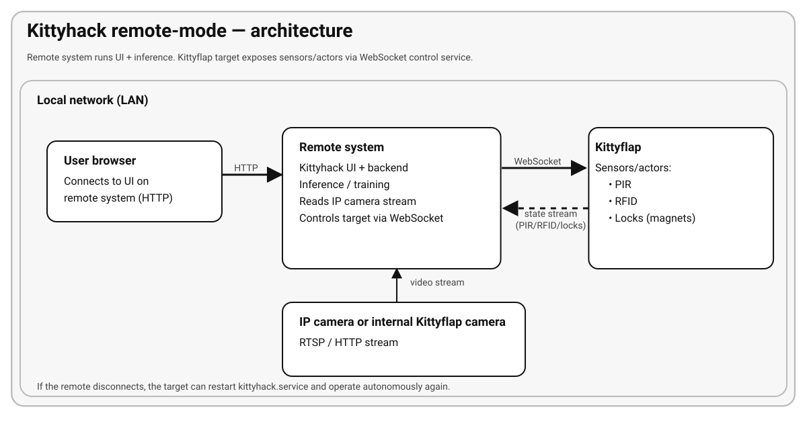
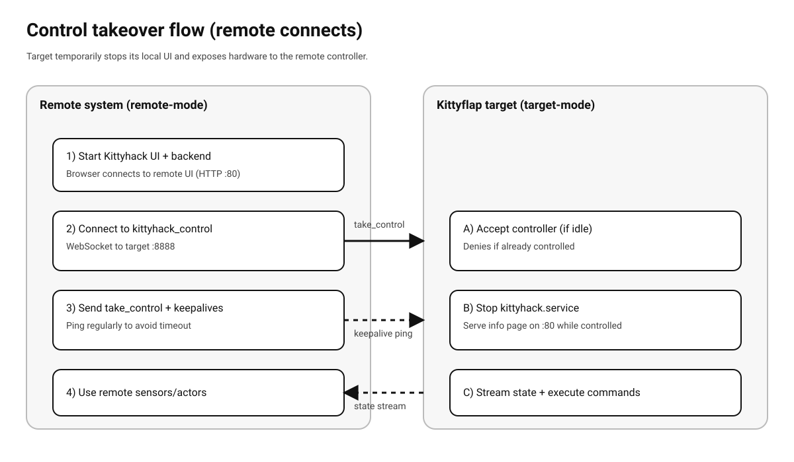
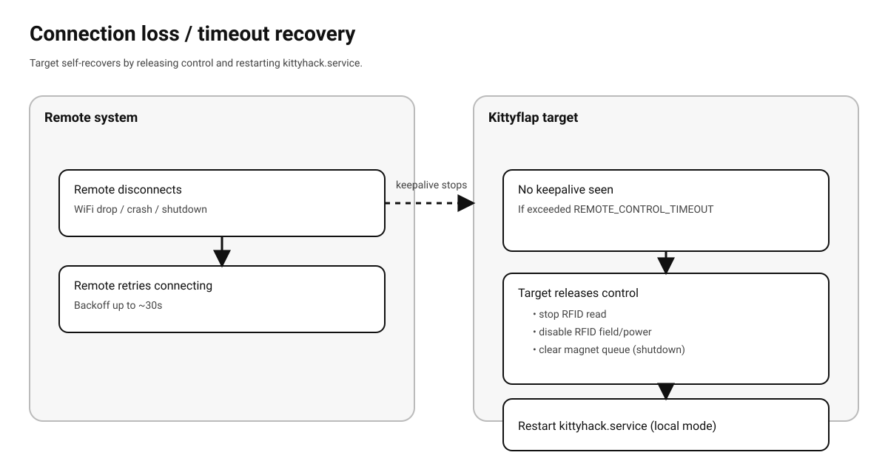

### Remote mode overview

Remote mode lets Kittyhack run across two devices:

- **Kittyflap**: the device continues to handle its sensors, RFID reader, and flap locks.
- **Remote device** (a separate Linux PC or VM): runs the Kittyhack web interface and detection.

This reduces the load on the Kittyflap. Depending on the remote hardware, it can also provide smoother cat and prey detection.
The remote device can use more complex models that do not run well on the Raspberry Pi 4 inside the Kittyflap.

---

#### What runs where?

##### On the Kittyflap
- Kittyhack runs locally by default.
- When a remote device takes control, the Kittyflap shows an information page instead of the usual interface.
- If the connection is lost, the Kittyflap automatically returns to local operation.

##### On the remote device
- Kittyhack runs the web interface and detection.
- Kittyhack connects to the Kittyflap and controls the device remotely.

---

#### Setup

1. Install/update Kittyhack on the **Kittyflap** as usual.
2. Install Kittyhack on the **remote device** and choose “remote mode” during setup.
   Setup script:
   ```bash
   sudo curl -sSL https://raw.githubusercontent.com/floppyFK/kittyhack/main/setup/kittyhack-setup.sh -o /tmp/kittyhack-setup.sh && sudo chmod +x /tmp/kittyhack-setup.sh && sudo /tmp/kittyhack-setup.sh && sudo rm /tmp/kittyhack-setup.sh
   ```
3. In the Kittyhack web interface on the remote device, enter the Kittyflap IP address.

Open the remote web interface in your browser:

- `http://<IP-of-remote-device>/`

---

#### Initial sync

During setup, you can transfer data from the Kittyflap to the remote device, including:

- models
- pictures
- database
- settings
- Label Studio data

This sync is available **only during setup**. You cannot start another sync later.

---

#### Where is data stored?

When a remote device controls the Kittyflap:

- New events are saved **only on the remote device**.
- Setting changes are saved **only on the remote device**.

If the remote device goes offline, the Kittyflap returns to local operation with the settings stored **on the Kittyflap itself**.

Over time, events and settings on the remote device and Kittyflap will differ.

You can end the remote connection from the Kittyhack web interface on the remote device. You can then change settings through the Kittyflap web interface again.

---

#### What happens if the connection is lost?

- The Kittyflap releases remote control.
- Any safety actions finish cleanly.
- The Kittyflap returns to local operation.
- The remote device will try to reconnect automatically later.

---

#### Software and hardware requirements

##### Remote device
- Debian or Ubuntu, ideally on a system dedicated to Kittyhack
- AMD64 (x86_64) CPU with at least 4 cores
- At least 4 GB RAM

##### Network
- The remote device must be able to reach the Kittyflap in your local network.
- The Kittyflap must be reachable on ports `80` and `8888`.
- This feature is designed only for a **trusted LAN** (do not expose it to the public internet).

---

#### Diagrams

##### Architecture: who talks to whom?



##### Control takeover: what happens when the remote device connects



##### Recovery after a lost connection


